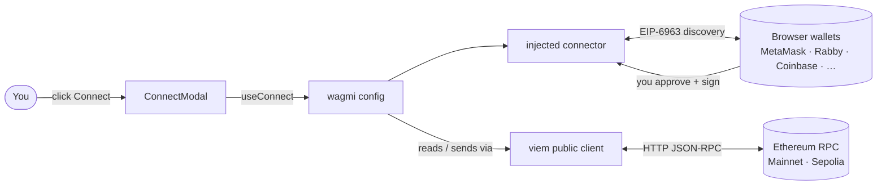

<div align="center">

# 🕸️ WEBLINE WALLET

**A non-custodial Ethereum wallet, swinging on a fullscreen animated ASCII web.**

Connect a wallet · See your ETH · Send & receive on **Mainnet** and **Sepolia**
*Your keys never leave your wallet. With great power comes great responsibility.*

<p align="center">
  
  
  
  
  
  
  
  
  
</p>

</div>

---

## 📖 Contents

1. [Launch sequence (quick start)](#-launch-sequence-quick-start)
2. [Your Spider-Man photo (required for the ASCII background)](#-your-spider-man-photo-required-for-the-ascii-background)
3. [The wallet adapter, explained](#-the-wallet-adapter-explained)
4. [Everything the wallet can do](#-everything-the-wallet-can-do)
5. [The ASCII background engine](#-the-ascii-background-engine)
6. [Project map](#-project-map)
7. [Configuration](#-configuration)
8. [Deploy](#-deploy)
9. [Security: the Spider-Sense checklist](#-security-the-spider-sense-checklist)
10. [Troubleshooting](#-troubleshooting)
11. [What was tested (and what was not)](#-what-was-tested-and-what-was-not)

---

## 🚀 Launch sequence (quick start)

You need **Node 18.18+** and **pnpm 10+** (`corepack enable` or `npm i -g pnpm`).

```bash
# 1. open the project folder (the one that contains package.json)
cd webline-wallet

# 2. add your photo (see the next section), then:
pnpm install
cp .env.example .env     # optional: add your own RPC URLs
pnpm dev                 # http://localhost:5173
```

| Command | What it does |
| --- | --- |
| `pnpm dev` | Dev server with hot reload on port 5173 |
| `pnpm build` | Type-checks, then builds to `dist/` |
| `pnpm preview` | Serves the production build locally (port 4173) |

> **Windows tip:** if you unzipped into a folder that contains another `webline-wallet` folder, `cd` into the **inner** one. pnpm must run where `package.json` is.
> `pnpm install` may list ignored optional build scripts (`bufferutil`, `utf-8-validate`). They are optional speed-ups; ignore them.

---

## 🖼️ Your Spider-Man photo (required for the ASCII background)

The fullscreen effect is drawn **from a photo you provide**. The project ships without one and draws no substitute figure. Without a photo the page stays dark.

1. Pick a **clear, close-up, front-facing photo** of the masked face, with **both white eyes visible**. Normal photos work much better than pictures that are already ASCII art. Make sure you have the right to use the image.
2. Save it into the `public/` folder as **`spiderman.jpg`**. The names `spiderman.jpeg`, `spiderman.png` and `spiderman.webp` also work.
3. Open <http://localhost:5173/spiderman.jpg>. If you see the picture, you are set. Reload the main page.

**Framing.** The photo's aspect ratio is always preserved (never stretched). It is fitted so the face stays whole, zoomed at most 1.35× past "contain", with the face centred and a soft fade where the photo does not reach the screen edge. If the face sits off-centre in your image, adjust `centerX` / `centerY` in `SUBJECT_FRAMING` inside `src/lib/ascii/source.ts`.

On Windows, turn on **File Explorer → View → File name extensions** so you do not end up with `spiderman.jpg.jpg`. In development, an amber notice appears at the bottom right when no photo is found.

---

## 🔌 The wallet adapter, explained

Ethereum has no single "wallet adapter" package. Webline's adapter layer is **wagmi's connector system**, set up in one file: [`src/config/wagmi.ts`](src/config/wagmi.ts).



### What the pieces mean

| Piece | Meaning |
| --- | --- |
| **Connector** | A plug that lets wagmi talk to one kind of wallet. Webline uses the `injected()` connector, which talks to wallets that live inside your browser. |
| **EIP-6963** | A standard where every installed wallet *announces itself* to the page. With `multiInjectedProviderDiscovery: true`, **each wallet appears as its own button** (with its own name and icon), so wallets do not fight over `window.ethereum`. |
| **Injected fallback** | If a wallet does not announce itself, wagmi still offers a generic "Browser wallet" button. |
| **Transports** | One RPC URL per chain. The wallet signs; the RPC node only answers reads and broadcasts. |
| **Chains** | `mainnet` and `sepolia`, from `wagmi/chains`. Nothing else is enabled. |

### How the app uses it

| File | Job |
| --- | --- |
| `src/config/wagmi.ts` | Creates the config: chains, the `injected()` connector, EIP-6963 discovery, RPC transports. |
| `src/main.tsx` | Wraps the app in `WagmiProvider` and `QueryClientProvider`, inside an `ErrorBoundary`. |
| `components/ConnectModal.tsx` | Lists discovered wallets via `useConnect`. Prefers named EIP-6963 wallets and falls back to the generic one. Shows a friendly message if no wallet exists. |
| `components/WalletHeader.tsx` | Connect / Disconnect button and the connected account chip (`useAccount`, `useDisconnect`). |
| `components/NetworkSelector.tsx` | Mainnet / Sepolia switch with `useSwitchChain`. Errors appear in plain English. |
| `hooks/useActiveChain.ts` | Works out which chain the UI shows, and whether the wallet is on an **unsupported** network. |
| `hooks/useEnsProfile.ts` | Resolves ENS name and avatar on **mainnet** (ENS lives there), whatever network you view. |
| `hooks/useTxState.ts` | Follows a transaction hash until the chain returns a receipt: pending → confirmed or failed. |

### Reconnect and disconnect behavior
- After a page reload, wagmi **reconnects the last wallet** automatically. The header shows "Connecting…" meanwhile.
- **Disconnect** clears the connection in the app. Your wallet extension keeps its own permissions; revoke them in the wallet if you want.
- Webline asks for **no** private-key access, ever. The wallet only exposes your public address and requests signatures you approve.

### Adding more wallet types
`connectors: [injected()]` is the only line to extend. For example, to add Coinbase Wallet or WalletConnect (mobile wallets via QR code), add wagmi's `coinbaseWallet(...)` or `walletConnect({ projectId })` connectors from `wagmi/connectors`. WalletConnect needs a free project ID from WalletConnect Cloud. These are **not** enabled by default.

---

## ⚡ Everything the wallet can do

| Power | How it works |
| --- | --- |
| **Connect** | Pick any detected browser wallet. |
| **Address** | Shortened in the header, full on the card, with **Copy** and **Explorer** buttons. |
| **ENS** | Shows your `.eth` name and avatar when set. |
| **Balance** | Live ETH balance for the active network, refreshed every 15 seconds, with loading and retry states. Never a fake number. |
| **Network** | Switch Mainnet ↔ Sepolia. An unsupported network shows a warning and a one-click switch. |
| **Send ETH** | Recipient (address **or** ENS name) and amount, validated before anything is sent. |
| **Fee estimate + Max** | The **Max** button fills *balance minus an estimated fee* (21,000 gas × current fee, plus a 20% safety buffer). Your wallet still shows the exact fee before you sign. |
| **Transaction states** | *Confirm in your wallet…* → **Pending** → **Confirmed** (with block number) or **Failed**. Read from the chain, not assumed. |
| **Explorer links** | Etherscan links for addresses and transactions on the right network. |
| **Receive** | Dialog with your full address, Copy, and Explorer link, plus a reminder to choose the right network. |
| **Recent transactions** | Transactions you sent in this visit, with live status. Kept in memory only and gone on reload. Webline invents no history. |
| **Disconnect** | One click in the header. |

### Errors are explained, not dumped
Rejected signatures ("Request cancelled in your wallet. Nothing was sent."), insufficient funds, unknown network, wallet not installed, unreachable RPC, nonce conflicts and low-fee rejections each get a short, actionable message (`src/lib/errors.ts`).

### Validation you will see
- Recipient must be a valid address (checksum-aware) or an ENS name that resolves.
- Amount must be a number greater than 0, with up to 18 decimals, and not more than your balance.

---

## 🎞️ The ASCII background engine

A custom **Canvas2D** renderer in `src/lib/ascii/` turns your photo into a fullscreen field of animated line cells. It re-implements the effect from the supplied render specification. It is not copied from any third-party code.

**Pipeline (per frame setup → per frame draw):**

1. Draw the photo at viewport resolution (aspect-preserving, face-centred).
2. Split into **10 px cells**; average each cell's colour and luminance.
3. Apply **brightness → contrast → saturation → grayscale → tint** (in that order).
4. Tone curve, **invert**, **Sobel edge emphasis** and **coverage** decide which cells draw and how thick.
5. Draw each cell as a **line** primitive on an offscreen layer.
6. Blend over a dimmed copy of the original with **colour-dodge**.
7. Post effects: **vignette, film grain, glitch bursts** (others are implemented but off).
8. Animate with the **flicker** style (smoothly interpolated so details fade rather than pop).

**Performance and care:**
- `requestAnimationFrame`, capped at **24 fps**; device pixel ratio capped at **2**.
- Animation never re-renders React; all drawing lives in the engine class.
- `ResizeObserver` + debounced resize; cells are slightly smaller on phones.
- Pauses when the tab is hidden; **respects `prefers-reduced-motion`** (shows a still frame).
- The canvas is `position: fixed`, `z-index: 0`, `pointer-events: none`, so the wallet UI always stays on top and clickable.
- Background dimming and blur appear **only while a dialog is open** (`dialog::backdrop`). Closing it restores the full effect.

**Tuning.** All preset values live in `src/lib/ascii/config.ts` and are the single source of truth: `renderMode`, `cellSize`, `coverage`, `styleBlend`, animation style, post effects, and more. The engine also supports optional glow points (`lights`) and a reveal mask (`mask`), both off by default. Blur supports `off` and `uniform` only; other blur types fall back to uniform.

---

## 🗺️ Project map

```text
webline-wallet/
├─ public/                    ← put spiderman.jpg here
├─ src/
│  ├─ main.tsx                 providers: ErrorBoundary → Wagmi → React Query
│  ├─ App.tsx                  canvas background + wallet UI layers
│  ├─ index.css                Tailwind + glass / button / dialog styles
│  ├─ config/
│  │  └─ wagmi.ts              🔌 chains, connectors, RPC transports
│  ├─ hooks/
│  │  ├─ useActiveChain.ts     current chain + unsupported-network flag
│  │  ├─ useEnsProfile.ts      ENS name and avatar (mainnet)
│  │  ├─ useTxState.ts         pending / confirmed / failed from the chain
│  │  └─ useCopy.ts            copy-to-clipboard with feedback
│  ├─ lib/
│  │  ├─ ascii/
│  │  │  ├─ config.ts          preset (source of truth)
│  │  │  ├─ source.ts          photo loading + subject-aware framing
│  │  │  └─ engine.ts          Canvas2D renderer (no React)
│  │  ├─ errors.ts             wallet / RPC errors → plain English
│  │  ├─ explorer.ts           block-explorer URLs
│  │  └─ format.ts             ETH + address formatting
│  └─ components/
│     ├─ AsciiSpiderManBackground.tsx   mounts the engine, owns lifecycle
│     ├─ WalletHeader.tsx · NetworkSelector.tsx · ConnectModal.tsx
│     ├─ WalletDashboard.tsx · BalanceCard.tsx · WalletActions.tsx
│     ├─ SendEthModal.tsx · ReceiveModal.tsx
│     ├─ TransactionStatus.tsx · TxBadge.tsx
│     └─ Modal.tsx · Avatar.tsx · CopyButton.tsx · Icons.tsx · ErrorBoundary.tsx
├─ docs/badges/               red-and-blue tech tags used in this README
├─ vercel.json · netlify.toml   deploy settings (pnpm)
├─ .env.example                 optional RPC URLs
└─ pnpm-lock.yaml
```

---

## ⚙️ Configuration

| Variable | Purpose |
| --- | --- |
| `VITE_MAINNET_RPC_URL` | RPC endpoint for Ethereum Mainnet (optional) |
| `VITE_SEPOLIA_RPC_URL` | RPC endpoint for Sepolia (optional) |

If a variable is empty, viem's built-in public RPC is used. Public RPCs are **rate-limited**, so use a dedicated provider (Alchemy, Infura, QuickNode…) in production.

> `VITE_*` values are bundled into the browser build. Use **domain-restricted** keys and **never** put secrets here.

---

## ☁️ Deploy

**Before deploying, add your photo** to `public/` (the page stays dark without it).

### Vercel
1. Push the project to GitHub and import it in Vercel.
2. `vercel.json` already sets the Vite preset, `pnpm install --frozen-lockfile`, `pnpm build` and output `dist`.
3. Add `VITE_MAINNET_RPC_URL` and `VITE_SEPOLIA_RPC_URL` under *Settings → Environment Variables*.
4. Deploy.

### Netlify
1. Import the repository in Netlify.
2. `netlify.toml` already sets build command `pnpm build`, publish directory `dist` and Node 20.
3. Add the same environment variables under *Site configuration → Environment variables*.
4. Deploy.

### Any static host
Run `pnpm build` and upload `dist/`. It is a single page with no client-side routes, so no rewrite rules are needed.

---

## 🛡️ Security: the Spider-Sense checklist

- Webline **never** asks for, stores, shows or transmits private keys or seed phrases. Signing happens only inside your wallet.
- Nothing sensitive is written to storage by the app. (wagmi remembers only which wallet you last connected, so it can reconnect.)
- **Always check** the recipient, amount, network and fee on your wallet's confirmation screen before signing.
- **Start on Sepolia.** Send a tiny test amount first.
- Sending ETH is irreversible. A wrong address means lost funds.
- Use a dedicated, restricted RPC key in production, never a secret key.
- Only install wallet extensions from their official sources.

---

## 🧰 Troubleshooting

| Problem | Fix |
| --- | --- |
| Background is dark, no Spider-Man | Add the photo to `public/` as `spiderman.jpg`. Check <http://localhost:5173/spiderman.jpg> shows the image. Watch for `spiderman.jpg.jpg`. |
| Background looks like blurry streaks | Use a clear, normal front-facing photo, not one that is already ASCII art. |
| `ERR_PNPM_NO_PKG_MANIFEST` | You are in the wrong folder. `cd` into the folder that contains `package.json`. |
| `pnpm` not found | Run `corepack enable`, or `npm i -g pnpm`. |
| "No browser wallet detected" | Install MetaMask, Rabby or another wallet, then reload. |
| Balance shows an error | The RPC is unreachable or rate-limited. Click *Try again*, or set your own RPC URL in `.env`. |
| "Unsupported network" banner | Your wallet is on another chain. Use the banner button or the Mainnet / Sepolia switch. |
| Send button disabled | The wallet is on an unsupported network. Switch first. |
| Transaction stays *Pending* | The network is busy. Check the Explorer link for the true status. |
| Changed `.env` but nothing changed | Stop and restart `pnpm dev`. Environment variables are read at start. |

---

## ✅ What was tested (and what was not)

**Tested** (automated browser runs against the production build):
- `pnpm install --frozen-lockfile`, TypeScript check, `pnpm build`, `pnpm dev` and `pnpm preview` all succeed from a clean copy.
- The full wallet flow against a **mock wallet with stubbed RPC responses**: connect, balance, send, confirmed state, switching to Sepolia, and invalid-input errors, with no page errors.
- The canvas fills the viewport at several sizes (desktop, ultra-wide, tablet, phone), sits behind the UI, and does not block clicks.
- Page dimming and blur appear only while a dialog is open and are fully removed afterwards.
- The effect renders from a test image (JPG, PNG and WebP loading confirmed).

**Not tested:**
- A real wallet extension, real RPC nodes, or real transactions. Try **Sepolia** first.
- Your own Spider-Man photo (none is included). Check the look yourself and tune `SUBJECT_FRAMING` if needed.

---

<div align="center">

*"With great power comes great responsibility."* Double-check every address before you sign. 🕸️

</div>
